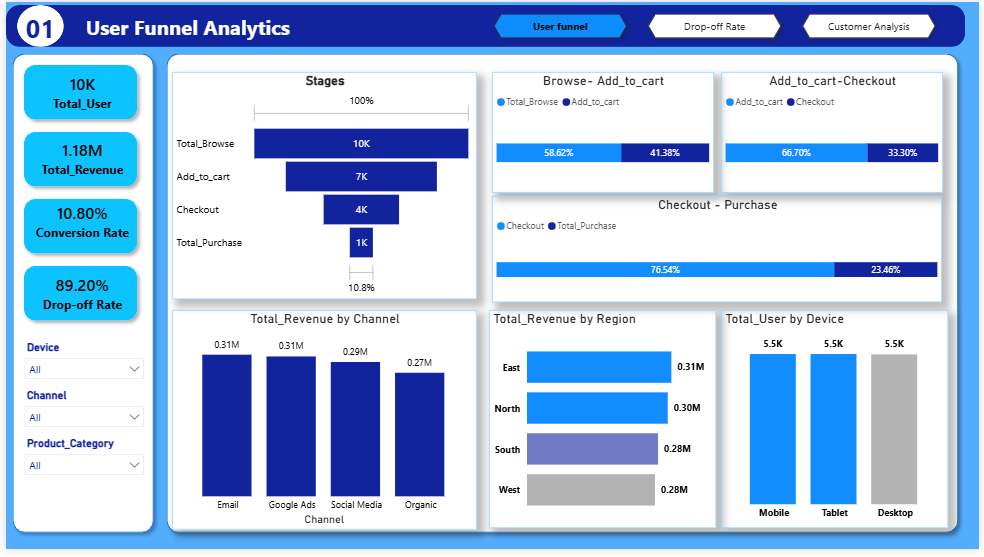
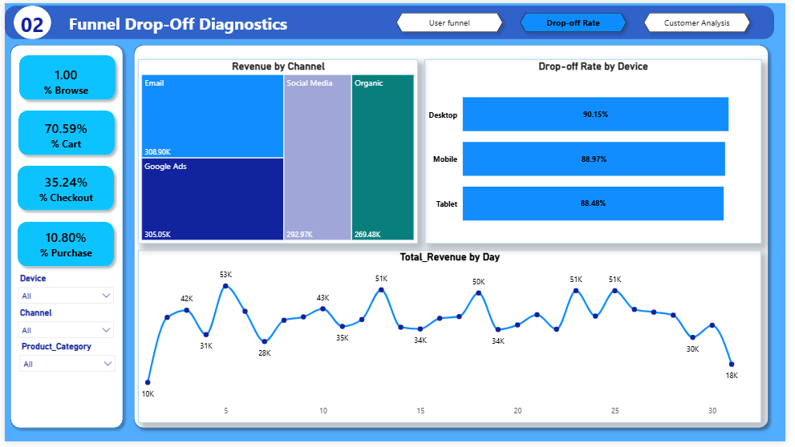
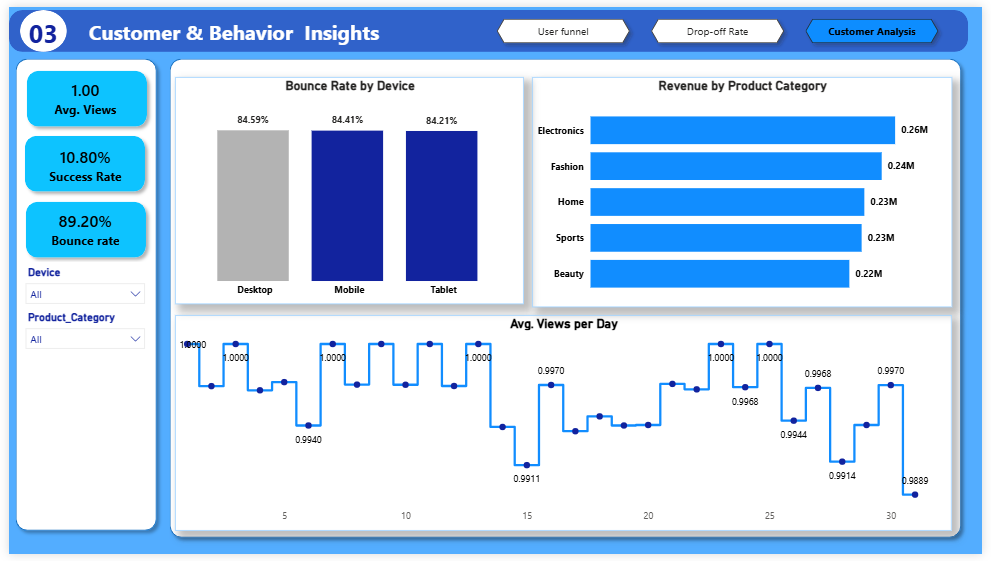

# E-Commerce User Funnel Analysis

## 📊 Project Overview

This project analyzes the e-commerce customer journey from **browsing → add to cart → checkout → purchase** to understand user behavior, funnel drop-offs, revenue performance, and opportunities for conversion improvement.

The analysis was developed in **Power BI** and provides an interactive view of key e-commerce performance metrics across channels, regions, devices, and product categories.

## 🔗 Interactive Power BI Dashboard

**View the interactive dashboard:**  
[Open Power BI Dashboard](https://app.powerbi.com/view?r=eyJrIjoiNTJhYjg3NzUtYWZmOS00NWZmLWJmOWQtOTJiMDhhMzUwYTBjIiwidCI6IjQ4NTkyZTczLTE2OTUtNGVmMy1hYzg3LWM0ZDNjMGVhNDYzMyJ9)

---

## 🖼️ Dashboard Preview

---

## 📌 Key Performance Indicators

| KPI | Value |
|---|---:|
| Total Users | 10K |
| Total Revenue | 1.18M |
| Conversion Rate | 10.80% |
| Drop-off Rate | 89.20% |

---

## 🔎 Key Findings

### 1. Which product generated the highest revenue?

Electronics generated the highest revenue.

### 2. Which channel generated highest revenue?
The dashboard does show revenue by acquisition channel:

- **Email:** 0.31M
- **Google Ads:** 0.31M
- **Social Media:** 0.29M
- **Organic:** 0.27M

Email and Google Ads have the highest displayed revenue among the channels, at approximately **0.31M each**.

### 3. Where do most customers drop off?

The funnel shows the following conversion progression:

**Total Browse → Add to Cart → Checkout → Purchase**

The largest stage-to-stage drop-off occurs between **Checkout and Purchase**:

- Checkout → Purchase: **76.54% drop-off**
- Add to Cart → Checkout: **66.70% drop-off**
- Browse → Add to Cart: **58.62% drop-off**

This indicates that the **checkout-to-purchase stage is the biggest point of customer loss** in the funnel.

The overall dashboard also reports an **89.20% overall drop-off rate**, meaning only a relatively small proportion of users who enter the browsing journey ultimately complete a purchase.

---

## 💡 Recommendations

### 1. Optimize the checkout experience

Since the largest stage-to-stage drop-off occurs between checkout and purchase, investigate potential friction points such as:

- Complicated checkout forms
- Unexpected shipping or additional costs
- Limited payment options
- Payment failures
- Slow page loading
- Lack of trust/security signals
- Poor mobile checkout experience
- Lack of guest checkout

Use checkout-abandonment data to identify the specific causes of the loss.

### 2. Improve the browse-to-cart journey

With **58.62%** of users dropping between browsing and adding an item to cart, improve product discovery and purchase intent through:

- Clearer product information
- Better product images
- Competitive pricing
- Stronger calls-to-action
- Personalized recommendations
- Reviews and ratings
- Relevant promotions

### 3. Investigate the add-to-cart → checkout drop-off

The **66.70%** drop between add-to-cart and checkout suggests that many users show purchase interest but do not proceed.

Consider testing:

- Cart reminders
- Limited-time incentives
- Free/discounted shipping thresholds
- Simplified cart pages
- Stock availability messaging
- Personalized retargeting campaigns

### 4. Investigate regional performance

Revenue by region is approximately:

- **East:** 0.31M
- **North:** 0.30M
- **South:** 0.28M
- **West:** 0.28M

Regional campaigns and customer experiences can be tailored based on differences in conversion behavior, purchasing patterns, and customer acquisition costs.

### 5. Analyze device-specific behavior

The dashboard shows approximately **5.5K users each** across Mobile, Tablet, and Desktop.

Because the funnel has a substantial checkout-to-purchase drop-off, device-level funnel analysis is particularly useful. Compare conversion rates and checkout abandonment across devices to determine whether a specific device experience is creating friction.

---

## 🛠️ Tools Used

- **Power BI** – Dashboard development and visualization
- **DAX** – KPI and funnel calculations
- **Data Analysis** – Customer funnel and revenue analysis

---

## 🎯 Business Objective

The objective of this analysis is to identify where customers are lost throughout the e-commerce journey and provide data-driven recommendations for improving **customer conversion, revenue generation, and overall shopping experience**.

---

## 👩🏽‍💻 Author

**Maryam Zubair Titilayo**  
Data Analyst | Computational Chemistry Researcher

> Turning data into insights that support better decisions.
